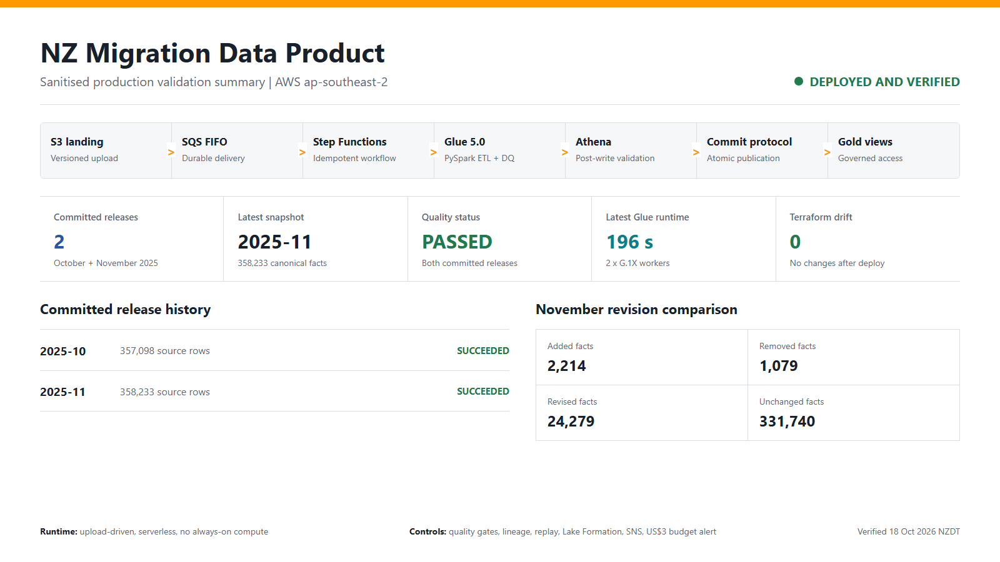
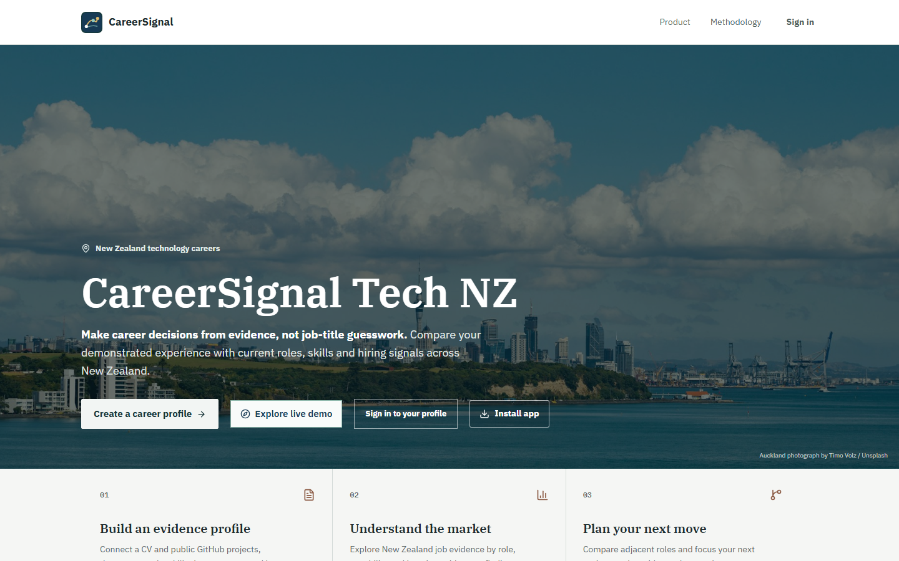
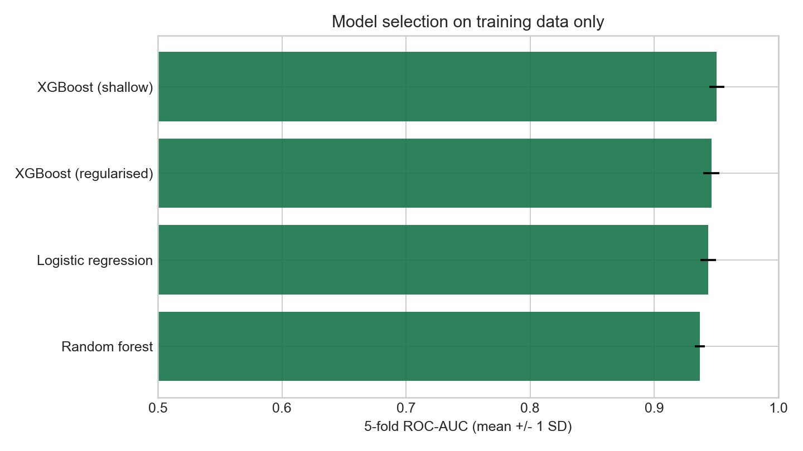
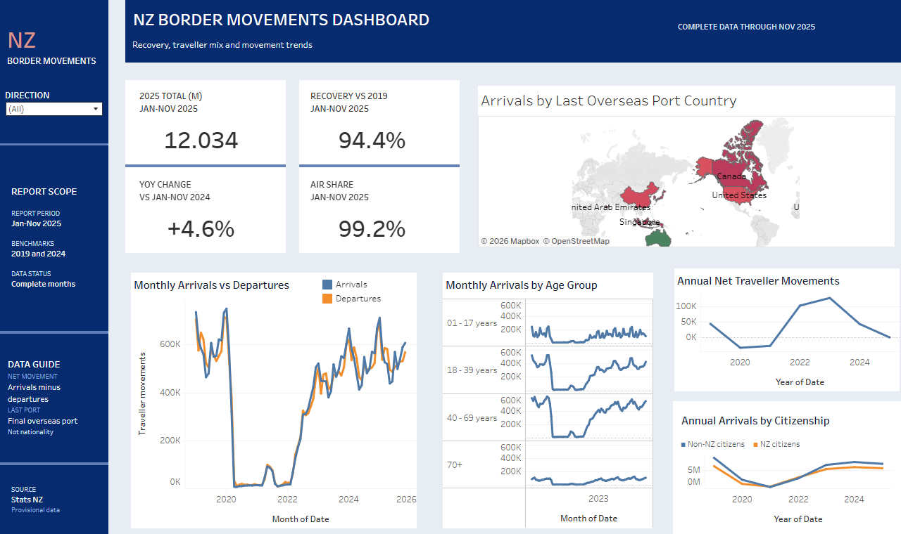
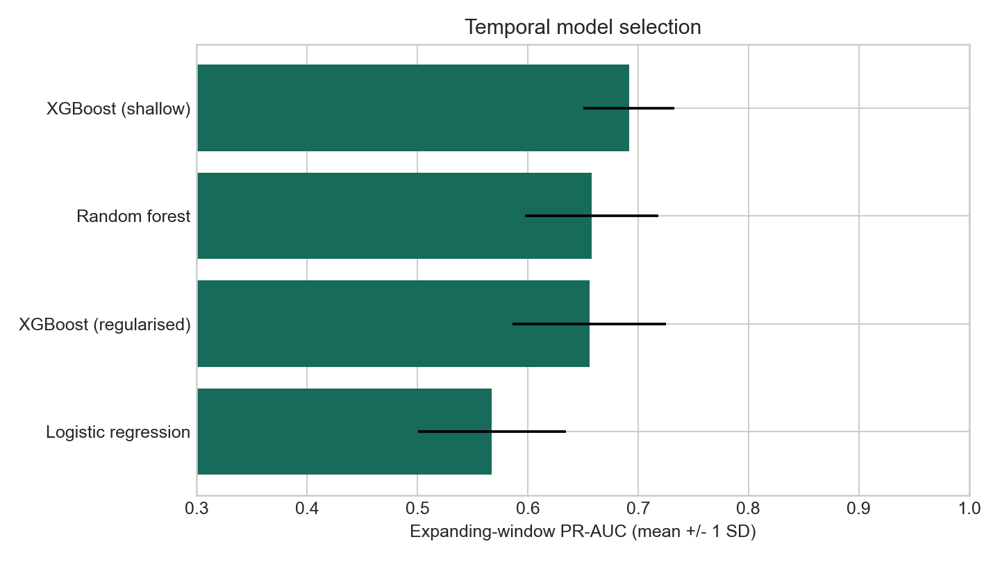
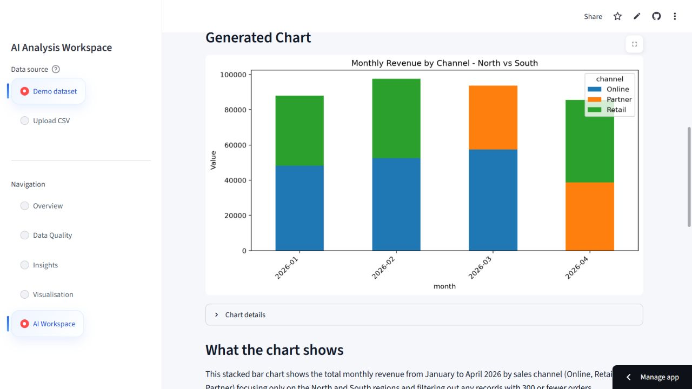
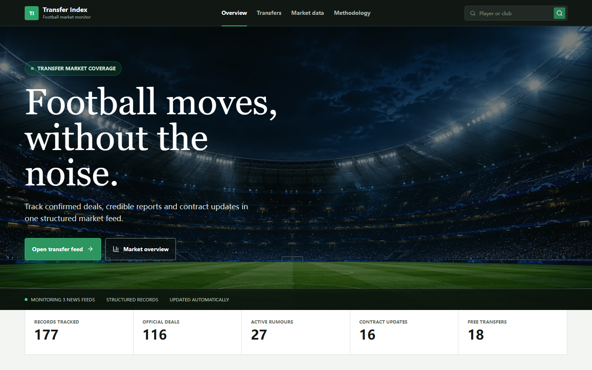

# Yang Li | Technical Portfolio

Master of Information Technology candidate based in Auckland, New Zealand. I
build data products and production-shaped software across AWS data engineering,
applied machine learning, full-stack AI applications, and business intelligence.

This portfolio contains seven curated projects with working deployments,
reproducible evaluation evidence, or published analytical artifacts. The focus
is on reliable data flow, explicit decision logic, honest validation, and
maintainable delivery rather than isolated notebooks or unverified prototypes.

## Technical focus

- **Data engineering:** AWS S3, EventBridge, SQS FIFO, EventBridge Pipes, Step
  Functions, Glue 5.0, DynamoDB, Athena, Lake Formation, Parquet, Terraform
- **Software and AI products:** React, TypeScript, Python, FastAPI, ASP.NET Core,
  PostgreSQL, pgvector, OpenAI APIs, Docker
- **Machine learning:** scikit-learn, XGBoost, temporal validation, probability
  calibration, SHAP, leakage control, reproducible inference
- **Analytics and BI:** Tableau, Streamlit, Pandas, Matplotlib, ECharts,
  metric governance and dashboard storytelling
- **Engineering quality:** GitHub Actions, Pytest, Ruff, Playwright, data
  contracts, security policies, model cards and operational runbooks

## Portfolio map

| Project | Primary evidence | Status |
| --- | --- | --- |
| [NZ Migration Data Product](#nz-migration-data-product-on-aws) | AWS-native data engineering | Deployed and validated |
| [CareerSignal Tech NZ](#careersignal-tech-nz) | Full-stack AI product engineering | Interview-demo beta |
| [NZ Telecom Churn ML](#nz-telecom-churn-ml) | Reproducible classification and decision policy | Stable v2 baseline |
| [NZ Border Movement Monitor](#new-zealand-border-movement-monitor) | Tableau BI and metric governance | Published dashboard |
| [Hotel Cancellation Risk ML](#hotel-cancellation-risk-ml) | Temporal validation and drift analysis | Stable v2 baseline |
| [AI Data Analysis Workspace](#ai-data-analysis-workspace) | Guarded natural-language analytics | Stable v1 demo |
| [AI Football Transfer Platform](#ai-football-transfer-platform) | Full-stack LLM extraction pipeline | Deployed demo |

## Flagship work

### NZ Migration Data Product on AWS

[Source code](https://github.com/liyang6620/nz-migration-data-pipeline-aws) |
[Deployment evidence](https://github.com/liyang6620/nz-migration-data-pipeline-aws/blob/main/docs/deployment_evidence.md) |
[Five-minute demo guide](https://github.com/liyang6620/nz-migration-data-pipeline-aws/blob/main/docs/interview_demo.md)

An upload-driven AWS data product for official Stats NZ migration releases. It
preserves immutable source versions, validates and transforms the complete
statistical cube, detects revisions, publishes partitioned Parquet atomically,
and exposes only committed snapshots through governed Athena Gold views.

- Built the production path entirely inside AWS: S3, EventBridge, SQS FIFO,
  EventBridge Pipes, Step Functions, DynamoDB, Glue, Athena and Lake Formation.
- Implemented version-aware idempotency, a dataset publication lock, quality
  gates, quarantine, replay, audit evidence, DLQ recovery and SNS alerts.
- Processed two complete releases; the latest committed snapshot contains
  **358,233** facts and identified **24,279** revised historical facts.
- Verified a **196-second** Glue run, two passing quality records and zero
  Terraform drift while maintaining a US$3 monthly budget alert boundary.

**Technologies:** AWS Glue 5.0, PySpark, S3, Step Functions, Athena, Lake
Formation, DynamoDB, Terraform, Parquet, Python

### CareerSignal Tech NZ

[Live web app](https://career-signal-tech-nz.pages.dev) |
[Source code](https://github.com/liyang6620/career-signal-tech-nz) |
[Android builds](https://github.com/liyang6620/career-signal-tech-nz/actions/workflows/android-apk.yml)

An evidence-based career intelligence platform for New Zealand technology job
seekers. It turns CVs, public GitHub repositories, governed job records and job
advertisements into reviewable capability evidence, role comparisons, career
pathways and a persistent application workflow.

- Built an authenticated product journey spanning evidence ingestion, market
  exploration, job decoding, capability profiling, pathways and applications.
- Kept evidence maturity, extraction confidence, source corroboration, market
  frequency and job priority as separate, inspectable signals.
- Added conservative PDF/DOCX and GitHub evidence extraction with user review,
  cited employer evidence, durable processing state and application history.
- Shipped the React client as a responsive web app, installable PWA and
  Capacitor Android APK backed by FastAPI and PostgreSQL.

**Technologies:** React 19, TypeScript, FastAPI, PostgreSQL, pgvector,
SQLAlchemy, ECharts, React Flow, Docker, Capacitor

### NZ Telecom Churn ML

[Live model workbench](https://nz-telecom-churn-ml-simulation-8murruu2syd4x2wry5ikcd.streamlit.app/) |
[Source code](https://github.com/liyang6620/nz-telecom-churn-ml-simulation) |
[Model card](https://github.com/liyang6620/nz-telecom-churn-ml-simulation/blob/main/docs/MODEL_CARD.md)

An end-to-end binary-classification study built around credible ML evidence.
The project separates the model-development process from the downstream
retention demonstration and makes every published result reproducible.

- Used isolated train, validation and untouched test sets with five-fold model
  comparison, Platt calibration and validation-only threshold selection.
- Achieved test ROC-AUC **0.9574**, PR-AUC **0.9181** and Brier score **0.0645**
  with bootstrap confidence intervals and an explicit cost-sensitive policy.
- Audited leakage, persisted the split and inference contracts, and used SHAP
  for model interpretation without making causal claims.
- Rebuilds models, calibration, reports and figures through one tested command.

**Technologies:** Python, XGBoost, scikit-learn, SHAP, Pandas, Streamlit,
Pytest, GitHub Actions

### New Zealand Border Movement Monitor

[Live Tableau dashboard](https://public.tableau.com/app/profile/yang.li7346/viz/nz-border-movements/NewZealandBorderMovementRecoveryMonitor) |
[Source and workbook](https://github.com/liyang6620/nz-border-movements-tableau) |
[Validation evidence](https://github.com/liyang6620/nz-border-movements-tableau/blob/main/docs/VALIDATION.md)

An interactive Tableau BI project monitoring New Zealand traveller movements
across the pre-COVID, restriction and recovery periods.

- Analyses **2.22 million** aggregated rows representing **60.87 million**
  movements, with comparable January-November periods and partial-month guards.
- Uses filter-aware KPI cards, desktop and phone layouts, drill-down views and
  explicit definitions for recovery, air share and net traveller movements.
- Avoids unsupported tourism, residence, labour-market and net-migration claims.
- Includes the packaged workbook, Hyper extract integrity tests, metric
  definitions, release screenshots and CI validation.

**Technologies:** Tableau, Hyper API, Python, Stats NZ data, GitHub Actions

## Additional selected work

### Hotel Cancellation Risk ML

[Source code](https://github.com/liyang6620/hotel-booking-cancellation-analytics) |
[Model card](https://github.com/liyang6620/hotel-booking-cancellation-analytics/blob/main/docs/MODEL_CARD.md)

An end-to-end cancellation-risk system evaluated at booking creation time. It
replaces an optimistic random-split experiment with duplicate removal,
expanding-window model selection, chronological validation and untouched
future-period testing.

- Test ROC-AUC **0.832**, PR-AUC **0.672** and calibrated Brier score **0.159**
  on 31,692 bookings from January-August 2017.
- Documents post-booking leakage exclusions, a cost-aware operating threshold,
  bootstrap intervals, SHAP interpretation and observed temporal degradation.
- Reproduces the preprocessor, model, calibrator, figures, tables and scoring
  contract through a tested training pipeline.

**Technologies:** Python, XGBoost, scikit-learn, SHAP, Pandas, Jupyter, Pytest

### AI Data Analysis Workspace

[Live demo](https://ai-data-analysis-workspace-j8qcctkchziuqghezkaxjm.streamlit.app/) |
[Source code](https://github.com/liyang6620/ai-data-analysis-workspace)

A local-first Streamlit workspace for CSV profiling, data-quality checks,
deterministic insights, natural-language analysis, direct chart rendering and
downloadable reporting.

- Manual analysis and the included demo dataset work without an API key.
- AI requests receive bounded dataset context rather than an unrestricted file.
- Chart generation uses a validated JSON specification and repository-owned
  rendering functions; model-generated Python is never executed.
- Supports guarded filters, aggregation, chart limits and clear rejection of
  unsupported joins, maps, forecasting, 3D output and custom dashboards.

**Technologies:** Python, Streamlit, OpenAI Responses API, Pandas, NumPy,
Matplotlib, Pytest, Ruff

### AI Football Transfer Platform

[Live demo](https://ai-football-transfer-platform.pages.dev) |
[Source code](https://github.com/liyang6620/AI-Football-Transfer-Platform) |
[API data](https://football-transfer-api.onrender.com/api/transfers)

A deployed full-stack application that collects football news, extracts
structured transfer information with an LLM and exposes searchable transfer
records through a responsive dashboard.

- Collects BBC Sport, The Guardian and Google News feeds with article retrieval,
  duplicate prevention and fault isolation between sources.
- Validates model-produced player, club, transfer type, fee, currency,
  confidence and summary fields before PostgreSQL persistence.
- Separates public read endpoints from API-key-protected crawling, reprocessing
  and mutation operations.
- Deploys the React frontend, ASP.NET Core API and Supabase PostgreSQL database
  as a working interview demonstration.

**Technologies:** React, ASP.NET Core 10, Entity Framework Core, PostgreSQL,
OpenAI API, RSS ingestion, REST APIs, Cloudflare Pages, Render

## Engineering baseline

The selected repositories include CI, setup and validation instructions,
licensing, contribution guidance, security reporting and explicit limitations.
Deployed demonstrations use free or tightly bounded infrastructure and should
be evaluated as portfolio environments, not unrestricted commercial services.

## Current interests

- Data engineering and cloud data platforms
- Full-stack software and AI-enabled products
- Applied machine learning and explainable decision support
- Data analytics and business intelligence

## Contact

- [LinkedIn](https://www.linkedin.com/in/yang-li-3613a6294/)
- [Email](mailto:liyang20001022@163.com)
